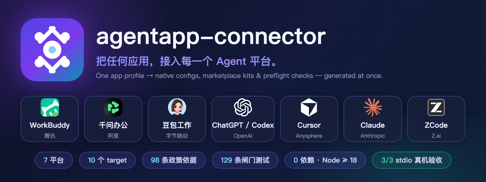

<div align="center">
  

  <h1>agentapp-connector</h1>

  <p><b>把任何应用，接入每一个 Agent 平台。</b></p>

  <p>一份应用档案 → <b>7 大 Agent 平台</b>的原生配置、市场上架材料与平台体检报告，一次生成。<br>
  <sub>One app profile → native configs, marketplace kits &amp; preflight checks for 7 agent platforms.</sub></p>

  <p>
    <a href="https://github.com/Harzva/agentapp-connector/stargazers"></a>
    <a href="https://github.com/Harzva/agentapp-connector/actions/workflows/ci.yml"></a>
    <a href="#-支持的平台"></a>
    <a href="#平台与客户端注册表"></a>
    <a href="docs/POLICIES.md"></a>
    <a href="#验证"></a>
    
    
    
  </p>

  <p>
    <a href="#-特性">特性</a> ·
    <a href="#-支持的平台">支持的平台</a> ·
    <a href="#-快速上手">快速上手</a> ·
    <a href="docs/POLICIES.md">政策与合规</a> ·
    <a href="CHANGELOG.md">变更历史</a> ·
    <a href="#-商标与素材来源">商标声明</a> ·
    <a href="docs/README_EN.md">English</a>
  </p>

  <p><b>本地模式已真机验收（stdio 3/3 verified）· 市场材料齐备但全部未提交（<code>NOT-SUBMITTED</code>）。这个项目不把占位说成已上架。</b></p>
</div>

---

独立开发的跨 Agent 应用连接器配置生成器。OpenBot 作为 MCP 服务端发布单个 Bot，本工具把同一个发布地址翻译成各 Agent 应用能用的配置；不依赖或复制 `agent-connector`，也不替代 OpenBot 自身的发布、授权与权限流程。

`openbot-workbuddy-connector`（stdio，6 工具）只是其中一个接入形态，在注册表里是 `workbuddy-stdio`。0.0.4 覆盖 **10 个 target / 7 个平台 / 98 条政策·本地·市场依据**，把每个平台的政策地址、本地模式、市场上架条件做成机器可读注册表，并由此生成三份文档与一套占位上架材料。

需要 Node.js 18 或以上，无第三方运行依赖。

## ✨ 特性

| | |
| --- | --- |
| 🧩 **平台差异全部吸收** | TOML 表 / camelCase / 嵌套 `mcp.servers` / UI 表单清单——逐平台按官方示例生成，绝不一份 JSON 走天下 |
| 📦 **市场材料一次成型** | 7 个平台的提交清单 + 占位包骨架全部由注册表生成，改一处全量重渲 |
| 🛡 **98 条政策·本地·市场依据** | 每条带 `fetched / indexed / sample / tutorial` 证据等级与取证边界，不编造条款 |
| 🩺 **平台体检三件套** | `doctor`（19 项只读探测 + stdio 真握手）、`local-status`（逐平台验证四态）、`market-preflight`（9 项前置检查） |
| 🧪 **129 条闸门用例** | 条数 + 退出码双校验；变更跑变异验证（rsync 副本逐条独立进程，全红才算钉住） |
| 🔌 **零依赖** | Node ≥ 18 即可运行，无任何第三方包 |

## 🧩 支持的平台

<table>
  <tr>
    <td align="center" width="14%"><br><b>WorkBuddy</b><br><sub>腾讯</sub></td>
    <td align="center" width="14%"><br><b>千问办公</b><br><sub>QwenWork</sub></td>
    <td align="center" width="14%"><br><b>豆包工作</b><br><sub>字节跳动</sub></td>
    <td align="center" width="14%">
      <picture><source media="(prefers-color-scheme: dark)" srcset="assets/logos/openai-white.svg"></picture><br><b>ChatGPT / Codex</b><br><sub>OpenAI</sub></td>
    <td align="center" width="14%">
      <picture><source media="(prefers-color-scheme: dark)" srcset="assets/logos/cursor-white.svg"></picture><br><b>Cursor</b><br><sub>Anysphere</sub></td>
    <td align="center" width="14%"><br><b>Claude</b><br><sub>Anthropic</sub></td>
    <td align="center" width="14%"><br><b>ZCode</b><br><sub>Z.ai</sub></td>
  </tr>
  <tr>
    <td align="center"><sub>本地 ✓ · 提交审核后发布</sub></td>
    <td align="center"><sub>本地 ✓ · 组织内提交</sub></td>
    <td align="center"><sub>本地 ✓ · 内测邀请制</sub></td>
    <td align="center"><sub>本地 ✓ · 目录审核</sub></td>
    <td align="center"><sub>本地 ✓ · 插件审核 · 须免费</sub></td>
    <td align="center"><sub>本地 ✓ · 目录审核</sub></td>
    <td align="center"><sub>本地 ✓ · PR 审核 · 可自带 stdio</sub></td>
  </tr>
</table>

> ✓ = 本工具已能生成该平台的本地配置与市场**材料**；市场材料全部是 `NOT-SUBMITTED` 占位骨架，**没有任何平台已提交或已上架**。小字为各平台的真实提交口径（`submissionSpec` 详情见[平台与客户端注册表](#平台与客户端注册表)）。平台名称、Logo 与商标归各自权利人所有，仅用于标识兼容性，详见[商标与素材来源](#-商标与素材来源)。

### 平台与客户端注册表

机器可读清单：`src/targets.mjs`（客户端格式）、`src/policies.mjs`（政策 / 本地模式 / 市场）、`src/packs.mjs`（上架材料）、`src/preflight.mjs`（提交前置检查）。`npm run docs` 生成 `docs/*.md`，`npm run packs` 生成 `marketplace/`；测试逐字比对产物与生成器，改了注册表没跑脚本会直接变红。

| 平台 | 本地模式 | 配置入口 | 市场上架 | `submissionSpec` |
| --- | --- | --- | --- | --- |
| WorkBuddy | stdio / streamableHttp / sse | `~/.workbuddy/mcp.json`，需 UI 点「信任」 | Connector 市场，提交审核后发布 | `official` |
| 千问办公 QwenWork | Streamable HTTP / SSE / STDIO | 扩展 → 连接器 → + 添加 | 扩展能力广场；公共市场个人上传「即将推出」，当前开放企业/组织内提交与审核 | `enterprise` |
| 豆包工作 | HTTP（Streamable HTTP）/ STDIO，仅本地电脑 | 插件·技能·伙伴 → 新建自定义连接器（表单） | 开放平台内测邀请制，接入规范需登录或入驻后可见 | `invite-only` |
| ChatGPT 桌面 / Codex CLI / IDE | STDIO / Streamable HTTP | `~/.codex/config.toml`，桌面与 CLI 共用 | ChatGPT App Directory，需组织提交权限与审核 | `official` |
| Cursor | stdio / sse / Streamable HTTP | `~/.cursor/mcp.json` 或 `.cursor/mcp.json` | Cursor Marketplace：发布者条款 + Plugins reference + `/marketplace/publish`；插件必须免费 | `official` |
| Claude / Claude Desktop | 本地 STDIO；远程连接器从 Anthropic 云端发起 | `claude_desktop_config.json` | Connectors Directory：submission 文档 + 开发者后台 + Directory Terms / Policy | `official` |
| ZCode | stdio / http / sse（嵌套 `mcp.servers` 键，全部作用域自动连接） | `~/.zcode/cli/config.json` | 插件市场：官方市场 `zai-org/zcode-plugins` 走 GitHub PR + 维护者审核；插件可自带 stdio MCP，不强制公网端点 | `official` |

`available` 只表示**存在市场路径**；`submissionSpec` 才表示有没有该类目的提交规范，以及是哪一种：`official`（公开自助提交规范）、`enterprise`（官方连接器规范已有，但当前只开放组织内提交）、`invite-only`（内测邀请制，规范登录后可见）、`none`（未找到公开规范）。各类平台都有材料，但后两类**不生成可提交包**。

98 条依据里：`fetched`（全文直取）43、`indexed`（地址核实、正文来自索引或抓取受限）44、本机样本 5、第三方教程 6。每条都带 `category / kind / evidence / note`，`note` 写明取证边界。

| target | 输出形态 | type / 传输 | 实机连接 |
| --- | --- | --- | --- |
| `qwenwork` | JSON | `streamable-http` | 未完成 |
| `workbuddy-http` | JSON | `streamableHttp` | 未完成 |
| `workbuddy-stdio` | JSON | `stdio` + `run.sh` | 未完成（协议层握手已通过） |
| `doubao-work` | 填表清单 | 表单里的「HTTP」 | 未完成 |
| `codex` | TOML 表 | `url` + `bearer_token_env_var` | 未完成 |
| `codex-stdio` | TOML 表 | `command` + `args` | 未完成（本机已安装） |
| `cursor` | JSON（不写 `type`） | `url` + `headers` | 未完成 |
| `zcode` | JSON（嵌套 `mcp.servers`，写 `type: "http"`） | `url`（headers 需真实值，模板不展开） | 未完成（本机已安装，配置未声明） |
| `zcode-stdio` | JSON（嵌套 `mcp.servers`，写 `type: "stdio"`） | `command` + `args`（绝对路径） | 未完成（本机已安装，配置未声明） |
| `claude-desktop` | JSON（不写 `type`） | `command` + `args` | 未完成（本机已安装，但客户端未装） |

格式差异不是小事：千问办公官方示例是 `mcpServers` + `type: "streamable-http"`；WorkBuddy 本机 catalog 的 122 个键里 `streamableHttp` 有 92 个、`streamable-http` 只有 2 个；Cursor 远程 MCP 不写 `type`；Codex 是 TOML 表而不是 JSON；豆包工作是表单；ZCode 用嵌套 `mcp.servers`、schema 严格（未知键整条服务被丢弃）且配置文件不展开 `${...}` 模板。0.0.1 把它们写成同一种，对多数客户端是错的。

**一处官方口径不一致已如实登记**：Cursor 官方 MCP 文档的 STDIO 字段表把 `type` 标为必填（值 `"stdio"`），但同页 CLI 示例不写。本机配置按示例生成，未在 Cursor UI 里复核前不擅自改，`liveTested` 保持 `false`。

## 🚀 快速上手

```sh
npm test                                   # 129 条闸门用例，退出码 0 才算过
node src/cli.mjs doctor                    # 本机 19 项只读探测 + stdio 真实握手
node src/cli.mjs market-preflight          # 7 个平台的上架前置检查
```

更多命令见[用法](#用法)。

## 用法

```sh
npm test                                   # 验收闸门
npm run docs                               # 重新生成三份政策 / 本地 / 市场文档
npm run packs                              # 重新生成 marketplace/ 材料
npm run targets                            # 列出全部客户端与未完成清单

node src/cli.mjs platforms                 # 平台注册表总览
node src/cli.mjs policies                  # 全部政策 / 协议地址（含证据等级）
node src/cli.mjs policies --format text     # 人可读版
node src/cli.mjs policies --platform cursor --category privacy
node src/cli.mjs local                     # 七个平台的本地模式
node src/cli.mjs market                    # 市场上架条件、阻塞项与 submissionSpec

node src/cli.mjs config 'http://127.0.0.1:4818/mcp/PUBLICATION_ID'
node src/cli.mjs config 'http://127.0.0.1:4818/mcp/PUBLICATION_ID' --target codex --auth placeholder
node src/cli.mjs config --target codex-stdio
node src/cli.mjs config --target claude-desktop
node src/cli.mjs guide  'http://127.0.0.1:4818/mcp/PUBLICATION_ID' --target doubao-work

node src/cli.mjs doctor                    # 本机只读探测 + 桥 HTTP 探测 + stdio 真实握手
node src/cli.mjs verify-local              # 真实发三个只读 tools/call（默认外层 20000ms）
node src/cli.mjs local-status              # 逐平台拆开：客户端 / 运行时 / 配置 / UI / 人工验证 / 验证结论四态
node src/cli.mjs market-preflight          # 七个平台的上架前置检查
node src/cli.mjs market-preflight --format text
node src/cli.mjs install-local --target codex 'http://127.0.0.1:4818/mcp/PUBLICATION_ID'
node src/cli.mjs install-local --target codex-stdio --write-to '~/.codex/config.toml'
node src/cli.mjs install-local --all                    # 10 个 target 逐平台计划，writes=0，绝不批量落盘
```

`doctor` 输出 JSON，把每项分成 `ok / blocked / unknown`。本轮新增 `openbot-bridge-http`：单独用 CLI 桥的 `endpoint.json` + `token` 请求 `/v1/status`，把「文件在」「端口能连」「HTTP 有响应」分开记。`verify-local` 同时看 `isError` **和返回体里的 `ok / reachable / code`**，并按错误码归一失败原因——`openbot_status` 在桌面没开时会返回 `isError=false` 但正文 `ok=false / reachable=false / OPENBOT_DESKTOP_NOT_RUNNING`，只看协议形状会误报成功。`verify-local` 默认外层等 20000ms，比上游连接器每次桥调用自带的 15000ms 长 5000ms（三个 `tools/call` 并发，不是 3 倍）；报告会把这次实际用的超时与「能不能看到上游错误码」一并带出来。

`install-local` 默认**只输出安装计划不写文件**；只有显式给 `--write-to` 才落盘，写前备份已存在文件，JSON 合并服务器表下的同名键（`mcpServers` 或 ZCode 的嵌套 `mcp.servers`）、TOML 追加一张表（已存在同名表时 `--force` 替换整张表，绝不追加重复表），写完回读比对。`--force` 才允许替换已有的 `openbot` 键 / 表；`--write-to` 覆盖 target 声明路径时会给出 `destinationOverridden` 与 `effectiveDestination`。

`install-local --all` 是逐 target 的批量**计划视图**：实测 `planOnly=true / writes=0 / count=10`，每条带 `platform / mode / destination / requiresUiForm / addressIsPlaceholder / postSteps`。HTTP target 用占位地址并标 `addressIsPlaceholder=true`；豆包工作标 `requiresUiForm=true`。它**拒绝** `--write-to`、`--force`、`--target` 与位置参数——七个平台里有 UI 表单、有客户端没装、有发布地址还没起服务，批量落盘只会制造「装好了」的假象。逐平台真实状态另看 `local-status`。

CLI 没有 `--token` 参数、不接受真实凭据；`--auth placeholder` 在 JSON 里只写 `Bearer ${OPENBOT_GRANT_TOKEN}` 字面占位符，在 Codex TOML 里只写环境变量名 `OPENBOT_GRANT_TOKEN`。库层的 `makeConfig` / `makeGuide` / `buildInstallPlan` 都拒绝未知选项。

完整政策地址见 `docs/POLICIES.md`。本轮又抓到 10 份官方全文并存进注册表：WorkBuddy 服务协议（9.2(g) 训练 opt-in、3.1 第三方集成风险）、千问办公服务协议（生效 2026-10-10，8.2–8.5 第三方接入责任、3.4(4)(5) 竞争产品与评测限制、10.3 数据境内）、豆包隐私政策、OpenAI 使用政策 / 服务条款 / `connectors-actions-terms`、Anthropic Usage Policy / DPA、Cursor 隐私政策 / MCP 文档。其中两点必须注意：

- **生效日期不是当前已生效**：Anthropic Usage Policy 页面写 `Effective Nov 12, 2026`，OpenAI Usage Policies 写 `Effective: November 20, 2026`（Changelog 2026-10-21），按本轮 2026-11-11 复核时都还没生效，提交前要按生效版本重核。
- **403 不是「没有规范」**：`developers.openai.com/apps-sdk/app-submission-guidelines` 直接抓取返回 HTTP 403 Forbidden，保留 `indexed` 并写明需登录开发者账号复核；腾讯 `rule.tencent.com` 的隐私保护指引 / 数据处理协议两页直接抓取只有「用户规则中心」一行，**正文缺失**，保留 `indexed` 并写明不能作为合规依据。腾讯开发者服务协议 4.3(7) 仍是搜索索引原文（禁止未经书面同意把含 API/模型能力的服务直接封装、转售、分发或作为同类 PaaS/MaaS 基础能力对外提供），提交前需按后台全文复核。

## 本轮在真实本机跑过的结果

**配置确实装进了真实客户端**（不是沙箱 HOME）：`~/.codex/config.toml` 追加 `[mcp_servers.openbot]` 的 stdio 表并备份 `~/.codex/config.toml.bak-1794351690847`；新建 `~/.cursor/mcp.json` 与 `~/Library/Application Support/Claude/claude_desktop_config.json`；三份写后回读一致。`~/.workbuddy/mcp.json` 原本已声明 `openbot`，未改动。因为 4818 没起、拿不到 publicationId，装的是本机唯一可用的 stdio 形态，没有写入不可达的 HTTP 地址。

**逐平台状态（上一轮真机 `local-status`，17 项 doctor 检查；本轮真实 home 被本机读保护拦截，见下）**：

| 平台 | 状态 | 原因 |
| --- | --- | --- |
| workbuddy | `runtime-blocked` | 客户端 / 配置都在，但 CLI 桥 HTTP 不应答 |
| qwenwork | `client-missing` | 本机没有千问办公客户端 |
| doubao-work | `needs-manual-verification` | 表单内容在客户端内部，磁盘无法校验 |
| chatgpt-codex | `declared` | 客户端与 `config.toml` 都在，客户端内调用待人工验证 |
| cursor | `declared` | 客户端与 `mcp.json` 都在，客户端内调用待人工验证 |
| claude | `client-missing` | 配置写了但 `/Applications` 里没有 `Claude.app`，没人读这份配置 |

**只读工具调用（`verify-local`）本轮没有拿到全绿，原因如实记录**：桌面端没运行时三个工具都报 `OPENBOT_DESKTOP_NOT_RUNNING`；`open -a OpenBot.app` 后 `endpoint.json` 出现（port 55066），但 `/v1/status`、`/v1/bots` 用 curl 6 秒 / 15 秒都零字节超时，TCP 却连得上；放大到 30 秒拿到连接器自身错误码 `OPENBOT_BRIDGE_TIMEOUT`（桥 15s 无响应；当时默认外层只有 12s，这轮已修，见下节）。随后 `endpoint.json` 自行消失，再启动也不再生成——本机 Electron 桌面在这个沙箱里起不住，与崩溃报告一致。`doctor` 现在如实报 `no-endpoint` / `blocked`。

同一会话的**上一轮**在桌面稳定运行时，三个只读工具曾 3/3 通过（OpenBot 1.0.33、43 个 Bot / 31 个可接文字任务、10 条历史任务），说明代码路径是通的；这一轮受阻的是本机运行时环境，不是 `verify-local` 的实现。不能把上一轮结果拿来冒充本轮全绿。

仍未通过：`4818` TCP 被拒绝（HTTP 发布服务没起）、`mcp-approvals.json` 为空（WorkBuddy **没点信任**）、千问办公客户端与 Claude Desktop 未安装、豆包工作连接器配置在客户端内部无法从磁盘校验（`unknown`）。所有 target 的 `liveTested` 仍是 `false`；`verify-local` 只调只读工具，没派发任务，也没验证 Bot 真的执行过任务。

### 本轮继续优化：`verify-local` 的默认超时口径

上一轮真机暴露的缺陷：连接器自己每次桥调用有 15s 超时（`connector.cjs` 的 `CALL_TIMEOUT_MS = 15000`），而 `verify-local` 默认只等 12s，默认运行只拿到「12000ms 内没有收齐 5 个响应」，必须手动 `--timeout-ms 30000` 才看得到 `OPENBOT_BRIDGE_TIMEOUT`。这轮把这一条做实：

- 登记 `CONNECTOR_CALL_TIMEOUT_MS = 15000`、`DEFAULT_VERIFY_TIMEOUT_MS = 20000`（15s + 5s 余量；三个 `tools/call` 并发，不是 3 × 15s）。`stdioExchange` / `runVerifyLocal` / CLI 用法都从这两个常量取值，不再各写一份硬编码；测试里期望值写字面数字，兄弟工程源码存在时另做交叉校验。
- 报告新增 `timeout`：`outerMs / connectorCallMs / defaultOuterMs / outerCanObserveConnectorCode`。显式把外层调到 15s 或更短，最后一项为 `false`，不假装能看到上游错误码；`runVerifyLocal` 用 `??` 接超时，显式传 0 / 负数会报错而不是被默认值悄悄盖掉。
- 外层超时但已有工具带着上游错误码回来时，`blockingReason` 解释那个错误码；`no-response` 不算根因，不会凭「没等到」编造故障结论。外层原文仍留在 `reason` 里不丢证据。
- 桥超时指引里的「15s」由上游常量生成，不再写死。

**对照实验**（15s 后才回 `OPENBOT_BRIDGE_TIMEOUT` 的假桥，真实子进程，不碰用户目录）：默认 20s → `status=ok`、三个工具都拿到 `OPENBOT_BRIDGE_TIMEOUT`、`blockingReason` 给出重启指引、`outerCanObserveConnectorCode=true`；显式 12s → `status=timeout`、三个工具错误码全丢、`failureKinds=['no-response']`、`outerCanObserveConnectorCode=false`、`reason` 明说「本次外层比上游短，可能在上游给出错误码之前就被截断」。

**真机边界如实说明**：这次默认 `verify-local` 直连真实连接器拿到的是 `OPENBOT_DESKTOP_NOT_RUNNING`（桌面没开），不是桥 15s 超时；上一轮那种「桥文件在、HTTP 不应答」的状态本机没能再次复现。所以「真实桌面上默认 20s 能否等过桥超时」仍待桌面稳定后复验，上面的对照实验只证明口径本身成立，不冒充真机 3/3 全绿。

### 本轮继续优化：`local-status` 逐平台验证结论

**缺陷**：`buildLocalStatus` 只要 `verdict !== 'verified'` 就给所有平台写 `verdict: 'not-applicable'` +「该平台没有可从外部进程直连的本地 stdio 连接器」。真机输出顶层明明是 `verificationVerdict: "partial"`（验证跑了且失败），`workbuddy` 行却既说事实说反（它恰恰是唯一能直连的那个），又把上一轮刚归一好的 `blockingReason` / `failureKinds` / `timeout` 全丢掉。这是「下层算对了、上层没读」的典型。

**修法**（`src/local-status.mjs`）：抽出 `STDIO_PLATFORM = 'workbuddy'` 与 `verificationFor()`，把结论分成四种——`verified`（带 summary）、失败（保留 `verdict`，透传 `blockingReason` / `failureKinds` / `summary` / `timeout` / `readOnlyOnly`）、`not-run`（`--no-verify` 或没跑，明确「这是没跑，不是判定结果」）、`not-applicable`（其余五平台）。下层没给原因时用兜底文案写明「不编造故障结论」，不退回「不适用」。新增一条用例直接把 `buildVerifyReport()` 的真实输出喂给 `buildLocalStatus()`，防止两层形状各自演进后脱节。

**真机前后对照**（`local-status --home /tmp/aac-fake-home`）：修复前 `workbuddy | not-applicable | 该平台没有可从外部进程直连的本地 stdio 连接器`；修复后 `workbuddy | partial | OpenBot 桌面端没运行，CLI 桥（endpoint.json / token）不存在；先打开 OpenBot.app 等主窗口出现再重试 | failureKinds=["desktop-not-running"] | outerMs=20000`，其余五平台仍是 `not-applicable`。

**取证用的环境限制，如实说明**：真实 home 下 `doctor` / `local-status` 本轮跑不起来——逐路径打点定位到单独 `readFileSync('~/.codex/config.toml')` 就会让整个进程被 SIGTERM（exit 137、零输出），`statSync` 显示它只是个 13KB 普通文件；`codex mcp list` 单独跑能正常 4 秒 ETIMEDOUT，握手、TCP、桥 HTTP 探测也都有各自超时。这是本机对该文件的读保护，不是产品代码缺陷（换异步读一样被拦），所以本轮用 `--home /tmp/aac-fake-home` 绕开个人目录真跑 CLI，`verify-local` 仍连的是真实连接器。**真实 home 下的 `local-status` 仍未复验**，已列入未完成清单。

### 本轮继续优化：坏端口不能让整份 `doctor` 报告消失

**缺陷**：`probeBridgeHttp` 只判 `Number.isInteger(port)`，没判范围；`http.request()` 是同步调用，越界端口会抛 `ERR_SOCKET_BAD_PORT`。旧实现让这个异常从 Promise executor 冒泡出去，`collectLocalFacts` 没有兜底，于是 `doctor` / `local-status` 的 17 项诊断整份消失。真机复现（临时 home 的 `cli-bridge/endpoint.json` 写 `{"port":70000}`、token 文件放占位串）：修复前 `EXIT=1 / JSON 0 字节 / stderr 只有一句 "Port should be >= 0 and < 65536"`。桌面崩溃时写出半份 endpoint.json 完全可能，这属于「字段被接受却没校验」而不是理论边界。

**修法**（`src/local.mjs`）：端口必须先落在 1–65535，越界直接返回 `bad-endpoint` 并带上 `port` 值；把 `http.request` 构造 / `request.on` / `request.end` 整段包进 try/catch，同步异常归一为 `request-failed`（带 `error.code` 与 message），绝不让上层报告崩掉；`BRIDGE_HTTP_STATUS` 把这两个状态都映射为 `blocked`（明确「桥不通」，不是 `unknown`）。`finish` 里的 `request.destroy()` 改成 `request?.destroy()`，避免构造失败时再触发 TDZ。测试用真实可复现的两种输入，不 mock：`port=70000 / 0 / -1`，以及 token 里带换行触发 `ERR_INVALID_CHAR`。

**真机对照**：修复后同一场景 `EXIT=0 / JSON 5751 字节 / checks=17 / openbot-bridge-http=blocked / detail="CLI 桥 /v1/status：bad-endpoint endpoint.json 里 port=70000 不在 1–65535 port=70000"`，其余检查项（stdio 握手、Claude 客户端等）照常产出。新增一条 CLI 端到端用例，直接断言「退出码 0 + 报告可解析 + 17 项都在」，把这次回归钉死。

**更正上一轮的一句推断**：上一轮写「换异步读一样被拦」，本轮实测发现不准确。异步 `fs.readFile('~/.codex/config.toml')` 时事件循环是活的（1.5s 的 `TIMER_ALIVE` 正常打出），只是读回调永不返回；`AbortSignal.timeout` 和 `Promise.race` 都能在 2s 后放弃并打印 `RESULT TIMEOUT`，但进程仍无法正常收尾、shell 被 SIGTERM。所以这是本机对该文件的读取拦截，不能简单归因为「同步阻塞」，也不能靠产品层加超时就宣称修好。本轮**没有**为此改 `collectLocalFacts`，也没把它算作已修复；真实 home 下的 `local-status` 仍未复验，未完成清单保持未勾。

### 本轮继续优化：报告里的 `nextStep` 也得按根因分

**缺陷**：上一轮把 `bad-endpoint` 的状态判对了，但 `openbot-bridge-http` 的 `nextStep` 仍是固定一句「endpoint.json / token 存在不代表桥能应答；确认桌面主窗口已出现，必要时重启 OpenBot.app」。真机报告里 detail 明明写着 `port=70000 不在 1–65535`，给人的动作却是重开桌面——**把动作带到错处且不报错**；上一轮真机还记录过「重启后 endpoint.json 不再生成」，所以这个指引不仅不对，还会白白耗掉一轮。

**修法**（`src/local.mjs`）：新增 `BRIDGE_NEXT_STEP`，与 `BRIDGE_HTTP_STATUS` 的 11 个状态一一对应。`bad-endpoint` 提示检查 / 删除 `endpoint.json` 让桌面重新生成；`request-failed` 指向 detail 里的错误码与 `ERR_INVALID_CHAR`；`no-endpoint` / `no-token` 才提示打开 App 等主窗口；**只有 `timeout` 提示重启桌面**；`http-error` 看 `httpStatus`；`skipped` / `unknown` 明说本次没有可用性结论。未知状态仍走通用兜底，不编造故障结论。`buildReport` 从表里按状态取指引。

**关键闸门**：测试断言两张表**键集合完全一致**（外加字面值 11）、所有指引**互不重复**——以后新增桥状态却忘了补指引会直接变红；另逐项用字面值断言 `bad-endpoint` / `request-failed` 不含「重启 OpenBot.app」、`timeout` 才含。上一轮的 CLI 端到端用例也补了这两条断言。

**真机对照**：同一坏端口场景，修复前 `nextStep="…确认桌面主窗口已出现，必要时重启 OpenBot.app"`；修复后 `nextStep="endpoint.json 的 port 缺失或不在 1–65535：检查文件内容，必要时删掉让桌面重新生成；单纯重启不保证会重写"`，17 项检查与退出码 0 不变。

### 本轮继续优化：TOML 同名表不能靠字符串包含判断

前四轮都在修「报告怎么如实呈现」，这轮查的是**写出去的数据**。`mergeTomlText` 用 `existingText.includes('[mcp_servers.openbot]')` 判「已存在同名表」，这不是结构判断。三种边界都复现了：

| 输入 | 旧行为 | 后果 |
| --- | --- | --- |
| `[ mcp_servers.openbot ]`（TOML 允许表头内空格） | 漏判 → 追加第二张表 | 非法 TOML |
| 已有 `[mcp_servers.openbot]` 且给 `--force` | 只跳过检查、继续追加 | 两张同名表；README 承诺的「替换」没兑现 |
| 注释里写 `# [mcp_servers.openbot] was here` | 误判为「表已存在」拒绝 | 明明没有表，白拒绝一次 |

标准解析器复核旧输出：`TOMLDecodeError: Cannot declare ('mcp_servers', 'openbot') twice (at line 4, column 21)`——这是真实的配置损坏，不是文案瑕疵。

**修法**（`src/install.mjs`）：新增 `findTomlTableRange()` 按行解析表头，容忍表头内空格与行尾注释、跳过注释行和键值行，返回该表到下一表头前的行范围；子表当作新表头，替换时保守保留。`--force` 现在**替换整张表**（保留表前表后内容、补回被吞掉的空行），`action` 从谎报的 `append` 改为如实的 `replace-table`。错误文案同步改成「确认要替换这张表请加 --force」，不再写「追加重复表」。

**真机复核**：把带空格表头、前后各有一张表 / 键值的文件用 `--force` 替换后，Python `tomllib` 解析 `PARSE_OK`，得到 `{'model': 'gpt-5', 'mcp_servers': {'openbot': {'url': 'http://127.0.0.1:4818/mcp/example'}}, 'other': {'a': 1}}`——旧值消失、表前表后内容都在、表头之间留了空行。新增 4 条用例覆盖表头识别、带空格不漏判、`applyInstallPlan` 端到端只留一张表且留备份、注释不再假拒绝。

### 本轮继续优化：跳过握手不是握手失败

前几轮修的都是「探测到了什么就怎么报」，这轮查的是**根本没探测**时报告怎么说。真机取证：

```text
$ node src/cli.mjs doctor --home /tmp/aac-fake-home --no-handshake
stdio-handshake => blocked | run.sh 握手未通过：skipped 调用方跳过握手
summary: {"ok":5,"blocked":11,"unknown":1,"total":17}
```

`detail` 自己写着「调用方跳过握手」，`status` 却是 `blocked`——自己跟自己矛盾，还把「没跑」算进 `blocked` 计数。`local-status --no-verify` 走的是同一条 `skipHandshake`，上层 `verification` 已经是如实的 `not-run`，下层却报失败。同类的 `skipped`（`port4818` / `bridgeHttp` / `codexCli`）本来就走 `unknown`，`stdio-handshake` 是唯一漏掉的。

**修法**（`src/local.mjs`）：`handshakeSkipped` 单独判，`checks` 状态改成 `ok` / `unknown`（跳过）/ `blocked`（真失败）三分支；跳过的 `detail` 写「本次未执行…这不是握手失败」、`nextStep` 指回去掉 `--no-handshake` / `--no-verify` 重跑；顶层 `stdioProtocolOk` 从二态改三态（`true` 通过 / `false` 失败 / `null` 没跑）。`summary` 由逐项统计得出，不额外补偿。

**真机对照**（同一条命令、同一个 home）：修复后 `stdio-handshake => unknown | run.sh 握手本次未执行：调用方跳过握手；这不是握手失败`，`stdioProtocolOk: null`，`summary` 从 `{"ok":5,"blocked":11,"unknown":1,"total":17}` 变成 `{"ok":5,"blocked":10,"unknown":2,"total":17}`，退出码 0、17 项检查完整。`local-status --no-verify` 的 WorkBuddy `verification` 仍是 `{"verdict":"not-run","reason":"本次没有运行 verify-local…"}`，没有被改成「不适用」。

**闸门**：新增 3 条用例（2 条 `buildReport` 纯函数 + 1 条 CLI 端到端），其中一条是**反向对照**——同一份 facts 只把 `handshake.status` 从 `skipped` 换成 `timeout`，握手必须回到 `blocked`、`stdioProtocolOk` 回到 `false`、`summary.blocked` 恰好 +1，防止「所有非 ok 一律变 unknown」这种半边闸门；CLI 用例还逐项核对 `summary` 与 `checks` 过滤后的数字一致。本轮 6 条变异全部变红（含「真正超时也记 unknown」的反向变异），逐条 sha256 还原，副本基线 106 条全绿。

### 本轮继续优化：`codex-config` 的表存在性不能再靠字符串包含

上一轮修的是**写盘**路径（`mergeTomlText` 用 `includes` 判同名表），这轮查的是**只读探测**：`doctor` 的 `codex-config` 检查项仍写着 `codexConfig.text?.includes('[mcp_servers.openbot]')`。同一份 `config.toml`，写盘按结构替换、探测按字符串猜，结论会互相打架。构造三份临时 home 下的真实 `~/.codex/config.toml`，用 Python `tomllib` 当独立裁判：

| 配置内容 | `tomllib` | 旧 `doctor` | 性质 |
| --- | --- | --- | --- |
| `[ mcp_servers.openbot ]`（TOML 允许表头内空格） | `PARSE_OK`，有表 | `blocked`，说「openbot 表=false」 | 漏判 |
| 只有注释 `# [mcp_servers.openbot] was here` | `PARSE_OK`，无表 | **`ok`**，说「openbot 表=true」 | **把没配置说成配好了** |
| 标准表头 `[mcp_servers.openbot]` | `PARSE_OK`，有表 | `ok` | 碰巧对 |

第二种最危险：用户照着报告以为 Codex 已接好，实际客户端根本没这张表。

**修法**（`src/local.mjs`）：复用上一轮验证过的 `findTomlTableRange()`，新增纯函数 `hasCodexOpenbotTable()`——按行识别表头、忽略注释与键值行、容忍表头内空格、子表 `[mcp_servers.openbot.extra]` 不算同一张表、非字符串输入直接返回 `false`。`codex-config` 的状态与 detail 都走它；detail 明写「按表头结构判断，注释不算、表头内空格算」。`install.mjs` 顶层只有 import 与常量，只读探测引入它不会触发任何写盘动作。

**真机对照**（同一批文件、同一个命令 `doctor --home <dir> --no-handshake`）：带空格 `blocked → ok`、只有注释 `ok → blocked`、标准表头 `ok → ok`；三次都是退出码 0、17 项检查完整。

**闸门与变异**：新增 3 条用例——纯函数表驱动（7 种形态，含子表 / 键值行里含表名 / `undefined` / 数字）、`buildReport` 注入三种 text、CLI 端到端真读两份临时 `config.toml`。本轮 **6 条变异全红**（`hasCodexOpenbotTable` 退回 `includes`、非字符串不再挡、报告层状态单独退回 `includes`、detail 去掉结构说明、反向把一切说成已配、共享解析丢掉空格归一化让只读与写盘一起退化），逐条 sha256 还原，副本基线 109 条全绿。

### 本轮继续优化：表头存在 ≠ 表可用

上一轮把 `codex-config` 修成「按表头结构判断」，但这只回答了「有没有声明」，没回答「声明能不能用」。构造四份临时 home 下的真实 `~/.codex/config.toml`，Python `tomllib` 当独立裁判：

| 表体内容 | `tomllib` 的 `table_keys` | 旧 `doctor` | 现在 |
| --- | --- | --- | --- |
| `[mcp_servers.openbot]` 后面什么都没有 | `[]` | **`ok`** | `blocked` |
| 表体只有一行注释 `# 还没填 command 或 url` | `[]` | **`ok`** | `blocked` |
| `command = "..." / args = []`（stdio） | `['args','command']` | `ok` | `ok` |
| `url = "..." / bearer_token_env_var = "..."`（HTTP） | `['bearer_token_env_var','url']` | `ok` | `ok` |

Codex 没有 `command`（stdio）或 `url`（HTTP）根本起不来 MCP server，空表报 `ok` 等于让人以为已经接好。

**修法**（`src/local.mjs`）：新增 `inspectCodexTable()`，在 `findTomlTableRange()` 给出的表体范围里按行扫描顶层 `key = value`（跳过注释行、字符串值里的 `command` 字样不算键、子表被下一表头截断），返回 `ready` / `empty-table` / `no-table` 与实际读到的键。`codex-config` 四态分开：`ready→ok`（detail 列 keys，nextStep 明说「这只是磁盘声明」）、`empty-table→blocked`（nextStep 指向 `--force` 替换整张表或补 `command`/`url`）、`no-table→blocked`（生成并追加）、**文件在但读不到→`unknown`**（`readTextSafe` 给 `text:null + error:'unreadable'`，拿不到证据不能推断已配或未配）。

**边界如实说明**：这是行级扫描，不是完整 TOML 解析器——不校验语法、不解析多行值与内联表；语法合法性仍以客户端与 `tomllib` 为准。本轮没有把它吹成「完整解析」。

**真机对照**（同批文件、同命令）：空表 / 只有注释 `ok → blocked`，`command` 与 `url` 两种仍 `ok`；四次退出码 0、17 项完整。

**闸门与变异**：新增 3 条用例——纯函数表驱动（空表 / 注释 / 字符串值 / 带空格表头 / 子表 / 无表 / 非字符串）、`buildReport` 四态与按根因分的 nextStep、CLI 端到端真读三份配置。首跑有 1 条红：上一轮用例把旧文案 `openbot 表=true` 钉死了，产品行为从「只判表头」升级到「还要判启动键」后 detail 跟着行为变；按结构把断言改成「已声明且含启动键」，**没有为迁就测试改产品文案**。本轮 **6 条变异全红**（有表就算可用、只认 `command` 丢 `url`、启动键判断退回字符串包含、空表也判 `ok`、读不到不再单列 `unknown`、nextStep 退回通用追加指引），逐条 sha256 还原，副本基线 112 条全绿。

### 本轮继续优化：把「键存在 ≠ 可用」的剩余三个调用点一次收口

上一轮修了 `codex-config` 的表体内容，但同一缺陷还有三处：`workbuddy-declared` / `cursor-config` / `claude-desktop-config` 都只写 `parsed?.mcpServers?.openbot ? 'ok' : 'blocked'`。真机四种 `~/.workbuddy/mcp.json`：

| 声明内容 | 旧 `doctor` | 现在 |
| --- | --- | --- |
| `{"mcpServers":{"openbot":{}}}` | **`ok`** | `blocked` |
| `{"mcpServers":{"openbot":{"type":"streamableHttp"}}}`（没有 url） | **`ok`** | `blocked` |
| `{"mcpServers":{"openbot":{"command":"...","args":[]}}}` | `ok` | `ok` |
| 文件不是合法 JSON | `blocked`（说没配） | **`unknown`**（拿不到证据） |

客户端没有 `command`（stdio）或 `url`（HTTP）起不来 MCP server；而 JSON 解析失败是「读不到」，既不是已配也不是没配。

**修法**（`src/local.mjs`）：新增 `inspectMcpDeclaration()`，返回 `unreadable` / `missing` / `incomplete` / `ready` 与实际 keys；三个检查项共用一个 `jsonCheck()` 渲染 helper，状态、detail、nextStep 只写一遍，不会各自漂移。`ready` 明说「这只是磁盘声明」、`incomplete` 指向 `--force` 替换 openbot 键或补启动键、`missing` 指向生成配置、`unreadable` 指向检查 JSON 语法与权限。JSON 字面上是 `null`（`error=null`）仍按 `missing`，不与读失败混为一谈；值里出现 `command` 字样也不算启动键。

**真机对照**（同批文件、同命令）：空对象 / 只有 `type` `ok → blocked`，合法声明仍 `ok`，非法 JSON `blocked → unknown`；四次退出码 0、17 项完整。

**夹具也如实改了**：`test/local.test.mjs` 的 `facts()` 原本把 `workbuddyMcp` 写成 `{ openbot: {} }`——正好是空对象，等于夹具一直在替这个缺陷打掩护。现在改成真实的 stdio 声明（含 `command` / `args`），空对象由新增用例单独覆盖。

**闸门与变异**：新增 3 条用例——纯函数表驱动（空对象 / 缺启动键 / 字符串值 / 非对象 / 数组 / 无键 / 文件不存在 / 解析失败 / 字面 `null`）、三个检查项同一输入的四态一致性、CLI 端到端真读四份配置。本轮 **6 条变异全红**，逐条 sha256 还原，副本基线 115 条全绿。

### 本轮继续优化：把 `codex-cli` 这一条数据链路做透

这一处盯得比前几轮深一层，同一个检查项发现三个叠在一起的问题：

1. **最上游 `runCommand` 把「退出码非 0」当成成功**：只看 `result.error`，进程正常结束但 `exit 3` 时照样返回 `status:'ok'`，报错时残留的 stdout 被当成有效证据；`stderr` 完全没收。
2. **`codex-cli` 只看 `status==='ok'`，从不读输出**：真跑本机 `codex mcp list` 拿到定宽表格 `Name / Command / Args / Env / Cwd / Status / Auth`，`Env` 列的值里带空格、列号不固定。按旧判据，只要命令退出 0，表格里**没有 openbot**、或 openbot 是 `disabled`、或输出根本不是表格，都会报 `ok`。
3. **`nextStep` 不是下一步动作**：原文是「codex CLI 不存在或超时时只记为 unknown，不推断『没有 MCP 服务器』」——一句关于报告口径的元描述，用户看完不知道该做什么。

**修法**（`src/local.mjs`）：

- `runCommand` 新增 `exit-error`（带 `code` 与 stderr 摘要），`ok` 只在退出码为 0 时给；三种 `error` 分支不变。
- `inspectCodexCli()`：表头必须含 `Name` / `Status` 列；用第一列 token 认行名、**行尾 3 个 token** 认 `enabled` / `disabled`（Env 列里有空格，按固定列位切必错）；返回 `registered` / `not-registered` / `disabled` / `unparseable` / `unavailable`。输出为空、表头认不出、状态值认不出、路径里带 `enabled` 字样都判 `unparseable`——**「看不到」不等于「没有」**。
- `codexCliPresentation()`：**命令层面的问题一律 `unknown`**（拿不到证据），只有输出里观察到的事实才判 `ok` / `blocked`；`skipped` / `not-found` / `timeout` / `error` / `exit-error` 五种各有动作指引且互不重复（测试逐项比对 Set 大小），`registered` 明说「这只证明 CLI 列出了它」。

**真机复核**：把刚才抓到的真实 `codex mcp list` 输出喂进解析器 → `{"verdict":"registered","status":"enabled","rowCount":4}`；`doctor --home /tmp/aac-fake-home --no-handshake` 真跑真实 codex 命令 → `codex-cli: ok | codex mcp list 里 openbot 状态 enabled（共 4 行）`，17 项完整、退出码 0。另用**注入 PATH 的假 `codex` 子进程**跑端到端 5 种场景（真实 spawnSync、真实退出码，不 mock 产品代码）：已注册 `ok`、没注册 `blocked`、`disabled` `blocked`、输出认不出 `unknown`、退出码 3 `unknown`。按旧判据推演，后四种都会被 `status==='ok'` 或泛化 `unknown` 掩盖——这里没有真跑旧二进制，不冒充前后对照。

**闸门与变异**：新增 4 条用例（`runCommand` 真跑退出码 3、`inspectCodexCli` 表驱动含路径含 `enabled` 的反例、`codexCliPresentation` 分状态与指引、CLI 端到端假 `codex` 五场景），夹具的 `codexCli.stdout` 从 `Name Command` 改成真实表格形状。本轮 **8 条变异全红**，逐条 sha256 还原，副本基线 119 条全绿。

### 本轮新增（0.0.4）：ZCode 作为第七个平台（本地模式 + 市场档案 + 占位包）

用户点名「要包括 zcode 市场」。本轮把 ZCode 完整接入注册表：2 个 target、1 个平台档案、8 条依据、1 套占位上架材料，测试 119 → **126 条全绿**。

**取证（全部本轮真跑）**：

- 官方文档站 `zcode.z.ai` 抓到两页正文：`/cn/docs/mcp-services`（用户级 `~/.zcode/cli/config.json` 与工作区级 `.zcode/config.json` 都用**嵌套 `mcp.servers` 键**；`~/.agents/mcp.json` 是同作用域回退且用顶层 `mcpServers`；stdio 字段 command/args/env；HTTP/SSE 填 url 与请求头；工作区服务与用户级一样**自动连接**；OAuth 只适用远程服务）与 `/cn/docs/plugin`（清单 `.zcode-plugin/plugin.json` 最小只需 name；市场清单在仓库根目录 `marketplace.json`；添加市场走 设置 → 插件 → 创建 → 添加插件市场）。`/cn/docs/mcp` 是 404，真实路径靠文档站导航页定位，不靠猜。
- 官方市场仓库 `zai-org/zcode-plugins` 用 `gh api` 抓到 README 与 **CONTRIBUTING.md 全文**：社区插件放 `external_plugins/<kebab-case>/`，清单必须含 name/description/version/author，marketplace.json 条目与清单一致，≥1 组件，**README.md + README_CN.md 双语必须**，类目七选一，禁止凭据/机器路径/构建产物，`validate.py` + `build_dist.py` + `git diff --check`，PR 模板必填 Plugin type，维护者按功能/安全/可维护性/兼容性/来源/许可证审核，已发布版本不可变。`submissionSpec` 据此登记为 `official`。
- 本机样本：`~/.zcode/cli/plugins/known_marketplaces.json`（已注册官方市场 zcode-plugins-official，CDN 分发 68 插件）与官方市场 `marketplace.json` 真实条目（source 带 sha256、`componentTypes: ["skill","mcp"]`、`publisherType`）——市场上架材料字段按真实样本核对。官方 zcode-guide / plugin-creator 插件随附文档（schema 严格、未知键整条服务被丢弃、**配置文件不展开 `${...}` 模板**、默认超时 30000ms）登记为 official/sample。
- **如实登记的缺口**：ZCode 平台侧服务条款 / 隐私政策本轮未取证，`policies` 数组刻意为空并在 blockers 与 notes 写明，不编造条款。

**形状差异驱动实现**：ZCode 的嵌套 `mcp.servers` 不是顶层 `mcpServers`，于是 target 增加 `mcpKeyShape` 字段，一处 `wrapServers()` 收口生成形状；`install.mjs` 的 `mergeJsonText` 按生成侧形状识别合并目标（保留 `mcp` 下兄弟键与 `plugins` 等其它设置，重复键报 `mcp.servers.openbot`）；`local.mjs` 的 `inspectMcpDeclaration` 按文件内容判断形状（有合法 `mcp.servers` 对象才按嵌套读，两套形状互不误认）。**凭据占位符是真实的平台差异**：配置文件不展开模板，`Bearer ${OPENBOT_GRANT_TOKEN}` 会被原样发出去，所以两个 zcode target 的 `authPlaceholderSupported=false`，`--auth placeholder` 直接拒绝并在 warnings 解释；插件作用域才支持 `${user_config.键}`，占位上架材料按这个原生机制写。

**真机边界**：本机 `~/.zcode/cli/config.json` 真实内容只有 plugins 启停状态、没有 `mcp.servers`（doctor 对真实状态报 `zcode-app=ok / zcode-config=blocked`，与事实一致）；本轮**没有写入真实 ZCode 配置**——合并与 `--force` 替换在临时目录与 `--home` 沙箱闭环验证，实际写入留给用户显式执行（`install-local --target zcode-stdio --write-to '~/.zcode/cli/config.json'`），且 ZCode 需重启会话才加载。

**市场档案要点**：ZCode 是七个平台里唯一的「插件包」市场——插件可自带 stdio MCP（插件作用域展开 `${CLAUDE_PLUGIN_ROOT}`），**不强制公网 HTTPS 端点**，是当前对 OpenBot 最可及的上架路径；但 blockers 如实写：插件源码树没有、stdio 依赖 OpenBot 桌面在线、双语 README 与副作用披露未备。占位包刻意把市场清单命名为 `marketplace.placeholder.json`——真名 `marketplace.json` 放在目录里会被 ZCode 当成可添加的本地市场，占位骨架不允许被直接安装。

**闸门与变异**：新增 7 条用例（zcode 配置形状与 auth 拒绝、ZCode 证据链 fetched/sample 分级、嵌套合并与兄弟键保留、`inspectMcpDeclaration` 双形状互不误认、doctor zcode 两项分状态、ZCode 占位包字段、CLI install→doctor 闭环），同步 6→7 平台、8→10 target、17→19 doctor 检查项等字面断言。**3 条变异全红**（`wrapServers` 无视形状 → 红 3；`inspectMcpDeclaration` 丢嵌套分支 → 红 3；`mergeJsonText` 丢嵌套识别 → 红 2），均在 rsync 副本独立进程跑，副本即弃，主仓 sha256 未动。`EXPECTED_CASES` 同步 126。

### 本轮附加：开源发布物料（为公开发布做准备）

- README 头部按 AstrBot / Composio / OpenConnector 的开源宣传风格重做：banner、居中 hero、事实徽章（7 平台 / 10 target / 98 依据 / tests 通过数 / node≥18 / 0 依赖）、7 平台真实 logo 墙（浅色 / 深色主题自动切换）与快速上手；正文记录全部保留，**宣传归宣传，「未提交」状态仍在首屏如实声明**。
- 7 个平台 logo 全部用真实来源：中国平台取各自官网 HTML 声明的官方 CDN 图标，OpenAI / Cursor / Anthropic / Claude 取 [Simple Icons](https://simpleicons.org/)（图标 CC0、商标归各公司）；来源与许可逐条登记在 `assets/logos/SOURCES.md`，README 末尾加商标声明与移除通道。
- `assets/banner.svg`、`assets/logo.svg` 为本项目原创；`assets/banner.png` 是进一步合成的**主 banner**：7 个平台真实 logo 芯片墙 + 数据胶囊（7 平台 / 10 target / 98 依据 / 129 测试 / 0 依赖），源文件 `assets/banner.html`、Chrome @2x 导出——第三方 logo 直接出现在首屏，且位图不受 GitHub SVG 代理对内部相对引用的限制。深色模式用的 `*-white.svg` 是单色图标的白色填充变体；`assets/social-card.svg/.png`（1280×640）供 GitHub 仓库社交预览手动上传。目检抓到并修复一个真缺陷：`cursor-white.svg` 由 CDN 原件派生时产生**重复 fill 属性**（XML 非法），浏览器静默拒载、首版 banner 该芯片裂图。
- 仓库发布配套：LICENSE（MIT，第三方商标除外）、.gitignore、GitHub Actions CI（Node 18/20/22 跑闸门 + 生成产物与注册表 diff 检查）、CONTRIBUTING.md（十条硬性纪律）、CHANGELOG.md（0.0.1 → 0.0.4）、英文简介 `docs/README_EN.md`。
- 新增 `test/assets.test.mjs` 2 条用例：README 引用的每个本地资产必须真实存在且非空（页面不裂图）；`assets/logos/` 每个文件必须在 SOURCES.md 登记来源，深浅色变体成对。`EXPECTED_CASES` 同步 128。测试曾抓到两处真实问题：README 用 `src="assets/..."` 写法而非 markdown 括号（正则先红后修），SOURCES 登记缺漏风险被制度化挡住。
- 发布前脱敏与渲染加固：HANDOFF 里的本机绝对路径改为相对描述；早轮真机写入的沙箱证据目录 `.local-install/` 进 .gitignore（结论已写在正文，仓库不带本机残留）；README 头部 `<div align="center">` 内的 markdown 全部改写为纯 HTML 标签——GitHub 对 div 内 markdown 的解析行为有历史歧义，纯 HTML 保证任何渲染器下居中、徽章与 logo 墙都按预期显示。CI 全序列本地预演（`docs → packs → test` + 产物 md5 前后比对）：生成产物零漂移，不会在 CI 的 diff 检查上误红。
- 收尾终验三件：①资产闸门扩展到**链接完整性**（README 与 `docs/README_EN.md` 里每个相对链接目标必须真实存在，死链直接红；用例数不变，断言范围收口进第 1 条）；②CI 的 diff 检查在**临时 git 仓库副本**上验证了两条路径——同步状态 `git diff --quiet` 成立（绿）、强制写入漂移被检出（红），这条 CI 逻辑从此有真实验证记录而不是「应该没问题」；③真机全命令面扫查 17 条只读 / plan-only 命令（`targets` ×10、`platforms` ×7、`policies` 98 条、`doctor` 19 项、`local-status` ×7、`market-preflight` ready=0、`install-local --all` writes=0、zcode/codex/表单各类 `config`/`guide`），退出码与输出形状全部符合预期，`liveTested` 仍全为 false 如实保持。
- **发布面泄漏闸门**：新增 `test/publish.test.mjs` 1 条用例——README / HANDOFF / docs / marketplace（递归）/ assets / `.github` 模板 / SECURITY 等 30+ 个发布面文本文件，逐一扫描真实凭据模式（CLI 桥 / grant token 前缀 + 随机串、各家 Bearer / sk / GitHub / AWS 密钥前缀、owner token 变量名）与本机用户目录、macOS 会话临时目录的绝对路径前缀；同时反向钉住「占位凭据必须仍在场」（Cursor 骨架的 `${OPENBOT_GRANT_TOKEN}`、ZCode 骨架的 `${user_config.*}`），防止有人把占位符也当泄漏删掉。变异验证：向副本 marketplace 注入一条带真实前缀的假 token，闸门逐文件点名命中。摸底结论：现有发布面**零泄漏**（`/tmp/aac-fake-home` 是通用占位名，无用户信息）。`EXPECTED_CASES` 同步 129。
- **闸门偶发失败的调查结论（如实记录）**：129 系闸门历史上出现过 2 次即时失败（均紧跟大规模文件编辑之后，仅退出码 1、未留下用例明细——当时只 grep 了 PASS/FAIL 行）。为定位它做了 15 次负载运行（4×CPU 燃烧 ×6、写入风暴+CPU ×3、加此前 Chrome 并发渲染场景），**全部通过，未能按需复现**；另有静默环境十余次连绿。判定为编辑风暴后的瞬时环境负载（spawn 类用例对启动延迟敏感），不是用例或产品缺陷；闸门失败时本就会完整打印 TAP 输出，再遇失败可自行定位。不做加重测试或放宽超时的无据改动。
- **真机本机验收链打通（2026-11-11 收尾轮）**：OpenBot 桌面 1.0.33 稳定在线后，`verify-local` 首次在本项目记录中拿到 **3/3 verified**（`openbot_status` / `openbot_bots` / `openbot_tasks` 全 ok，exit 0，超时口径 `outerCanObserveConnectorCode=true`）；真实 home 完整 `doctor` 19 项通过（历史读保护问题消失）；`local-status` 逐平台验证结论 workbuddy=`verified`。这完成了此前 P1 的「桌面稳定后重跑 verify-local」与「真实 home 复跑」两项；仍未完成的是客户端 UI 层：WorkBuddy「信任」未点、zcode 配置未写入、千问 / Claude 客户端未装——`liveTested` 保持 false 不变。
- **单独克隆复验**：在无同级 OpenBot 工作区的干净副本里跑闸门（129 条全绿）与 `doctor`（19 项完整、悬空连接器路径如实上报、registryProblems=0），确认仓库不依赖任何仓库外文件即可通过验收；据此在「前提与边界」补上「本仓库不含 stdio 连接器本体」的诚实说明（此前只暗示了一句，单独克隆的人会找不到 `run.sh`）。
- OSS 标配三件：`.github/PULL_REQUEST_TEMPLATE.md`（硬性自检清单：闸门、EXPECTED_CASES、生成产物同步、变异记录、证据等级）、`.github/ISSUE_TEMPLATE/bug-report.md`（环境信息 + 脱敏提醒 + 「没跑 ≠ 失败」的报告纪律）、`SECURITY.md`（本工具不收凭据的安全边界、私密报告通道、使用须知）。logo 墙小字从清一色「市场 ✓」改为各平台真实提交口径（组织内提交 / 内测邀请 / 目录审核 / PR 审核·可自带 stdio）。

## 市场上架材料与前置检查

`marketplace/` 由 `src/packs.mjs` 从政策注册表生成，`npm run packs` 重新生成，全部标记 `NOT-SUBMITTED`：

- 七个平台各一份 `SUBMISSION.md`。`official` 五家（WorkBuddy / ChatGPT / Cursor / Claude / ZCode）额外给占位包骨架；`enterprise` 的千问办公给提交清单 + OpenAPI 请求体占位（只到组织内提交）；`invite-only` 的豆包工作只给清单与入驻路径，**不伪装成可提交包**。
- `SUBMIT-STEPS.md` 由 `src/preflight.mjs` 生成：共通硬缺口 + 逐平台第一步 + 动作序列 + 9 项未清前置项。`market-preflight` 实测 `count=7 / readyCount=0 / submitted=0`，七个平台 `ready=false`、各有 9 个 `missing`。
- `workbuddy/` 是 Connector 包占位，`cursor/` 与 `zcode/` 是各自官方 Plugin 格式占位（ZCode 用 `.zcode-plugin/plugin.json` + `marketplace.placeholder.json`，后者刻意不叫 `marketplace.json`，避免占位骨架被当成可添加的本地市场直接安装）；占位端点一律 `https://mcp.example.invalid/mcp`（RFC 2606 保留域），凭据只写环境变量名或 `${user_config.*}` 占位，清单里没有真实 token、没有本机地址、没有「已上架 / 已通过审核」的措辞。

**这些材料不能提交。** 缺的是公网 HTTPS 常驻 MCP Server、OAuth / DCR、多用户隔离、工具 `title / readOnlyHint / destructiveHint` 注解与输出 schema、真实主体与图标、隐私政策与带样例数据的审核测试账号。Cursor 发布者条款 3.1 要求市场插件免费、6.3 禁止用插件数据训练模型，这是商业化口径，不是技术检查项。

## 前提与边界

- **本仓库不含 stdio 连接器本体**：`workbuddy-stdio` / `codex-stdio` / `zcode-stdio` / `claude-desktop` 默认指向的 `connector.cjs` / `run.sh` 位于 OpenBot 工作区的同级目录 `../openbot-workbuddy-connector/`（独立实现，不属于本仓库）。单独克隆本仓库时该默认路径会悬空——`doctor` 会如实报 `blocked` / spawn 失败，HTTP 形态、市场材料与全部闸门测试不受影响（已在无同级工作区的干净副本里复验：129 条全绿）。可用 `--connector-path` 指向任意符合 MCP stdio 协议的可执行文件。
- 使用本机发布地址时，所有接入形态都依赖 OpenBot 桌面 App 在线；「设置 → 应用连接 → BOT API 与 MCP 服务」需在界面里手动启动，默认仅监听 `127.0.0.1:4818`，退出即停服、重开需再启、不重放在途任务。本轮实测的是不依赖 4818 的 CLI 桥 stdio 路径。
- 当前 OpenBot 没有公网常驻 MCP Server。公开市场普遍要求公网 HTTPS、认证、主体资质、包结构与审核；`docs/MARKETPLACE.md` 逐平台列了条件和阻塞项。
- Claude 远程自定义连接器由 Anthropic 云端发起，`127.0.0.1` / 内网 / VPN 后的地址连不上；这里只做本地 STDIO。ChatGPT 网页版不读取本机 `config.toml`，只能走插件提供的远程 MCP。
- WorkBuddy 开放平台《入驻开放平台》同时列有企业 / 其他组织 / 个人认证，上线报道也写明个人开发者可入驻并开发管理连接器，**不能笼统写成「必须企业主体」**；但公开发布权限仍以后台实际入口为准。
- 千问办公当前版本不允许个人用户向公共扩展市场上传或发布自定义能力；企业空间只在组织内共享，不等于公开上架。豆包开放平台是内测邀请制，没有公开自助提交入口。
- 凭据应使用发布时生成的受限 grant token（`bot:read / bot:invoke / bot:cancel`），不要用桌面 owner token。`workbuddy-stdio` / `codex-stdio` / `claude-desktop` 例外：它们读取桌面启动时写出的 CLI 桥 token，是 owner 权限。
- 地址只允许 HTTPS，或本机的 HTTP；不接受带账号密码、查询参数或片段的地址。

## 验证

- `npm test` 走 `test/gate.mjs`：同时校验退出码、用例条数（登记 `EXPECTED_CASES`）、失败/跳过/取消/待办为 0、测试文件非空。新增或删除测试必须同步这个登记值。
- `npm run test:raw` 直接跑 `node --test`，用于排查。
- 关键格式断言写字面值，不从被测实现读回常量；`codex-stdio` 的 TOML 输出、Cursor 变量声明、政策 URL、`submissionSpec` 映射、安装路径覆盖标记、错误码映射、超时常量（`15000` / `20000`）都有独立字面断言并附交叉校验（上游 `connector.cjs` 存在时读它的 `CALL_TIMEOUT_MS` 核对登记值）。文档与包骨架的一致性用例逐字比对 `renderDocs()` / `renderPacks()` 与磁盘内容。
- `npm test` 里包含对内置 stdio MCP 假服务器做真实子进程握手 / `tools/call`、对临时 HTTP 与 TCP 服务做 200 / 500 / 超时 / 拒绝分原因探测、对 `mcpServers` 合并 / TOML 追加 / 备份回读的测试。
- 用例总数随轮次增长，闸门同步登记（写于 codex-cli 轮时点为 119 条 / 10 个测试文件；0.0.4 起为 **129 条 / 12 个测试文件**全绿，退出码 0）。抗变异分批做：历史 27 条（14 + 超时口径 7 + `local-status` 6）在更早的副本跑过、全部变红；随后八轮各跑 4 / 4 / 5 / 6 / 6 / 6 / 6 / **8** 条——坏端口轮（去掉端口范围校验、构造异常继续外抛、`request-failed` 降 `unknown`、`bad-endpoint` 降 `unknown`）、指引轮（退回统一重启指引、`bad-endpoint` 改回重启、`request-failed` 复制 `timeout` 文案、指引表漏掉 `unknown`）、TOML 轮（表头空格不再归一化、退回 `includes`、force 改回追加、谎报 `append`、删掉空行补偿）、skipped 轮（`unknown` 退回 `blocked`、detail 写回「握手未通过」、nextStep 退回通用指引、`stdioProtocolOk` 退回二态、整条 skipped 分支失效、反向把真正超时也记 `unknown`）、`codex-config` 轮（退回 `includes`、非字符串不再挡、报告层单独退回 `includes`、detail 去掉结构说明、反向全报已配、共享解析丢掉空格归一化）、表体轮（有表就算可用、只认 `command` 丢 `url`、启动键退回字符串包含、空表也判 `ok`、读不到不再单列 `unknown`、nextStep 退回通用指引）、JSON 声明轮（有键就算可用、只认 `command` 丢 `url`、解析失败不再单列 `unknown`、共用 helper 用 `declared` 判 `ok`、修复指引退回通用生成、启动键判断退回字符串包含）、本轮 `codex-cli` 轮（退出码检查失效、表头校验失效、没注册也说已注册、状态判断退回全行字符串包含、命令层失败改判 blocked、disabled 改判 ok、五种指引压成一句、检查项退回只看 status），45 条全部变红、逐条 sha256 还原，副本基线分别复跑 96 / 99 / 103 / 106 / 109 / 112 / 115 / 119 条全绿。**每轮只跑当轮变异**，不重跑历史批次：测试变慢后全量串行有超时中断、留下未还原变异的风险；历史结论按各自副本记录，不冒充本轮重跑过。第一次跑发现「忽略正文 `ok=false`」是等效变异——补了「`isError=false` 且没有错误码」的真实形态用例后它才被咬住。

## 尚未完成

- [ ] 10 个 target 在客户端内的实机连接（`liveTested` 全为 false）；目前只验证了从外部进程直连 stdio 连接器
- [x] **桌面稳定后重跑 `verify-local` 拿到 3/3 全绿（2026-11-11 收尾轮完成）**：`verdict=verified`、三个只读工具全 ok、OpenBot 1.0.33 在线（桥 port 64089）、外层 20000ms / 上游 15000ms 口径成立、退出码 0；完整 `doctor` 19 项同步通过（stdioProtocolOk=true，早前的 `~/.codex/config.toml` 读保护已消失）；`local-status` 的 workbuddy 验证结论翻为 `verified`。注意这仍是「外部进程直连 stdio 连接器」层面的验收，各平台客户端 UI 内的实机调用（liveTested）不变，仍为 false
- [ ] 桌面恢复到「桥文件在、HTTP 不应答」状态时，复验默认 20s 真能等过上游 15s 超时并拿到 `OPENBOT_BRIDGE_TIMEOUT`（当前只有 15s 慢桥的对照实验，不是真机）
- [x] **真实 home 下 `doctor` / `local-status` 复跑完成（同轮）**：读保护已消失，完整 `doctor`（含握手）退出码 0；`local-status` 逐平台：workbuddy `needs-ui-trust`（验证结论 `verified`）、chatgpt-codex / cursor `declared`、qwenwork / claude `client-missing`、doubao-work `needs-manual-verification`、zcode `config-missing`（配置未写入，符合预期）
- [ ] ZCode：`~/.zcode/cli/config.json` 尚未写入（`install-local --target zcode-stdio --write-to '~/.zcode/cli/config.json'` 后重启会话，在 设置 → MCP 确认 connected 才算实机验收）；平台侧条款未取证待补
- [ ] 启动 4818 HTTP 发布服务，跑通 HTTP 端点的 MCP 握手与 `tools/call`
- [ ] WorkBuddy 自定义连接器的 UI「信任」；`mcp-approvals.json` 现在为空
- [ ] 千问办公客户端 / Claude Desktop 安装；豆包工作表单与 OAuth 授权实测；Cursor STDIO `type` 字段口径在 UI 里复核
- [ ] 腾讯规则中心开发者服务协议 4.3(7)、隐私保护指引、数据处理协议的后台全文复核；豆包服务商连接器规范登录后复核
- [ ] Anthropic Usage Policy（2026-11-12 生效）与 OpenAI Usage Policies（2026-11-20 生效）按生效版本重核
- [ ] 公网 HTTPS 常驻 MCP Server、OAuth / DCR、多用户隔离、凭据轮换、工具注解、目录元数据、隐私政策、测试账号与真实包资产；`marketplace/` 现在全是占位符

## 📮 商标与素材来源

本项目与所列平台无隶属、合作或背书关系。所有平台名称、Logo 与商标归各自权利人所有，在本仓库中仅用于**标识兼容性**。

| 素材 | 来源 | 许可 / 依据 |
| --- | --- | --- |
| WorkBuddy 图标 | open.workbuddy.cn 页面声明的官方 CDN 图片 | 平台商标，权利人保留所有权利 |
| 千问办公图标 | qwenwork.cn 页面声明的阿里 CDN 图标 | 平台商标，权利人保留所有权利 |
| 豆包工作图标 | doubao.com 页面声明的官方 CDN 图标 | 平台商标，权利人保留所有权利 |
| ZCode 图标 | zcode.z.ai 官方 favicon | 平台商标，权利人保留所有权利 |
| OpenAI / Cursor / Anthropic 图标 | [Simple Icons](https://simpleicons.org/)（`openai` / `cursor` / `anthropic`） | 图标按 [CC0](https://github.com/simple-icons/simple-icons/blob/develop/LICENSE.md) 发布；商标权利归各公司 |
| Claude 图标 | [Simple Icons](https://simpleicons.org/)（`claude`） | 同上 |
| Qwen 图标（备选） | [Simple Icons](https://simpleicons.org/)（`qwen`） | 同上 |
| 项目 banner / logo / 社交卡片 | 本仓库原创（`assets/banner.svg` / `banner.html`+`banner.png`、`assets/logo.svg`、`assets/social-card.*`）；`banner.png` 内嵌的平台 logo 权利同上表 | 随仓库分发 |

权利人若认为任何素材的使用不妥，请提 Issue，我们会尽快移除或替换。

## 📄 许可证

代码按 [MIT](LICENSE) 发布；`assets/logos/` 里的平台商标与图标**不在 MIT 范围内**，归各自权利人所有（详见上表与 [assets/logos/SOURCES.md](assets/logos/SOURCES.md)）。欢迎按 [CONTRIBUTING.md](CONTRIBUTING.md) 的纪律提 PR；变更历史见 [CHANGELOG.md](CHANGELOG.md)。
