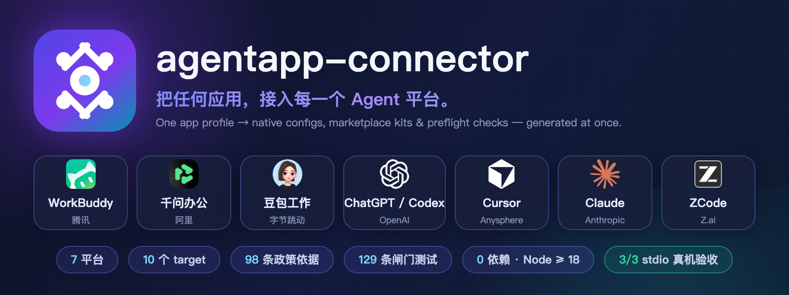

<p align="center"></p>

<h1 align="center">agentapp-connector</h1>

<p align="center">
  <a href="../README.md">中文</a> ｜ English
</p>

**Connect any app to every agent platform.** One app profile → native MCP configs, marketplace submission kits and preflight checks for **7 agent platforms**, generated at once. The stdio path is verified end-to-end against a live OpenBot desktop (**3/3 read-only tools**).

`agentapp-connector` ships OpenBot's Bot as an MCP server to mainstream agent platforms. It absorbs every platform's quirks so you don't have to:

| Platform | Local config | Marketplace kit | Submission spec |
| --- | --- | --- | --- |
| WorkBuddy (Tencent) | ✓ | ✓ | `official` |
| QwenWork 千问办公 (Alibaba) | ✓ | ✓ | `enterprise` — org-scoped only for now |
| Doubao Work 豆包工作 (ByteDance) | ✓ | ✓ | `invite-only` |
| ChatGPT / Codex CLI (OpenAI) | ✓ | ✓ | `official` |
| Cursor (Anysphere) | ✓ | ✓ | `official` |
| Claude Desktop (Anthropic) | ✓ | ✓ | `official` |
| ZCode (Z.ai) | ✓ | ✓ | `official` — plugin marketplace, PR-based review |

✓ = this tool generates the config / submission material. **Every marketplace kit is a `NOT-SUBMITTED` placeholder** — this project never pretends a placeholder was submitted or listed.

## Highlights

- 🧩 **Platform quirks absorbed** — TOML tables vs camelCase vs nested `mcp.servers` vs UI forms, each generated from official examples, never one JSON for everything
- 🛡 **98 pieces of policy evidence** — every entry graded `fetched / indexed / sample / tutorial`; no invented clauses
- 🩺 **Health checks** — `doctor` (19 read-only probes + real stdio handshake), `local-status` (per-platform four-state verification), `market-preflight` (9 submission preconditions)
- 🧪 **129 gate tests** — case-count + exit-code dual check; behavior changes are pinned by mutation runs on rsync copies
- 🔌 **Zero dependencies** — Node ≥ 18, nothing else

## Quick start

```sh
npm test                       # 129 gate tests, exit 0 or it fails
node src/cli.mjs doctor        # read-only local probing + real stdio handshake
node src/cli.mjs market-preflight   # what's still missing before any marketplace submission
```

> Unlike SaaS-to-agent gateways (Composio, OpenConnector) that wire existing SaaS APIs into agents, this tool works the other way around: it publishes **your own app** as an MCP server into agent platforms.

```sh
git clone https://github.com/Harzva/agentapp-connector.git && cd agentapp-connector && npm test
```

See the [Chinese README](../README.md) for the full usage, the engineering round-by-round log, the policy evidence library, and the honest "not done yet" list.

## License & trademarks

Code is [MIT](../LICENSE). Platform names, logos and trademarks belong to their respective owners and are used solely to identify interoperability — see [`assets/logos/SOURCES.md`](../assets/logos/SOURCES.md). This project is not affiliated with, endorsed by, or connected to any of the platforms listed.
